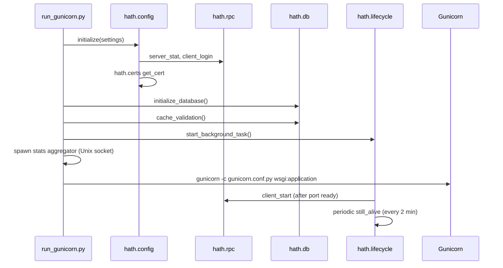
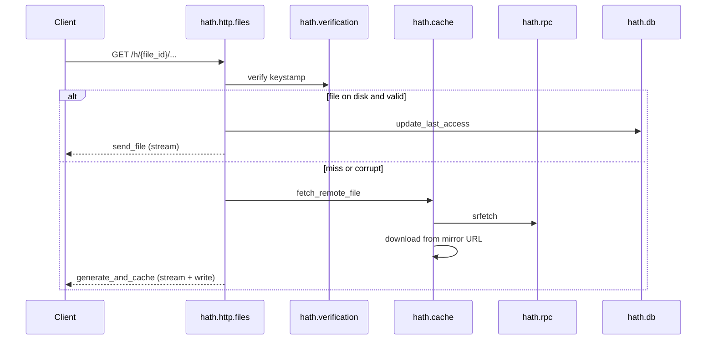
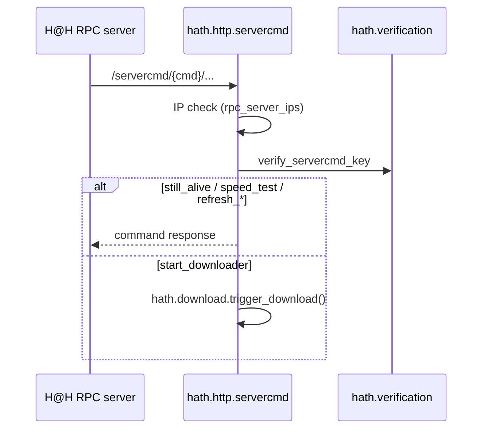

# Architecture

## Startup sequence

## Cache miss (`GET /h/...`)

## Server command dispatch

## Shutdown

1. `SIGINT` / `SIGTERM` → `hath.lifecycle.notify_client_stop()`
2. RPC `client_stop` sent if startup completed
3. `config/config.json` removed; DB connections closed
4. Gunicorn workers exit

## Configuration flow

- **Main process**: `hath.config.initialize()` fetches live config from RPC and writes `config/config.json`
- **Singleton**: one `Config` dataclass (`get_config()` / `replace_config()`). Server key/values live on `Config.server`
- **Gunicorn workers**: `hath.http.app.create_app()` loads cached JSON via `load_from_config_file()`
- **Hot reload**: a newer `config.json` reloads throttle, disk limits, RPC IPs, static ranges, and credentials into the existing process. Log level follows `disable_logging` or the local override. Listen port, data directories, and certificate paths stay as they were at process start. `refresh_settings` writes the file and does not restart Gunicorn
- **Paths**: `settings.py` → `initialize()` → `Config` → `hath.paths` helpers

## Metrics aggregation

Workers keep hot counters in memory and POST deltas every ~10s to `config/hath-stats.sock`. The parent process also pushes download gauges. Authenticated `GET /status/<actkey>` and `GET /metrics/<actkey>` on Gunicorn proxy that socket. `/metrics/<actkey>` is Prometheus text. `/health` is checks-only and is not a Prometheus target.

## Gunicorn reload (cert refresh)

`refresh_cert` servercmd downloads a new PKCS#12 bundle, then sends `SIGUSR2` to the Gunicorn master (see `hath.lifecycle.restart_gunicorn()`). Workers reload with the updated certificate files on disk. Host and port changes still require a process restart.
